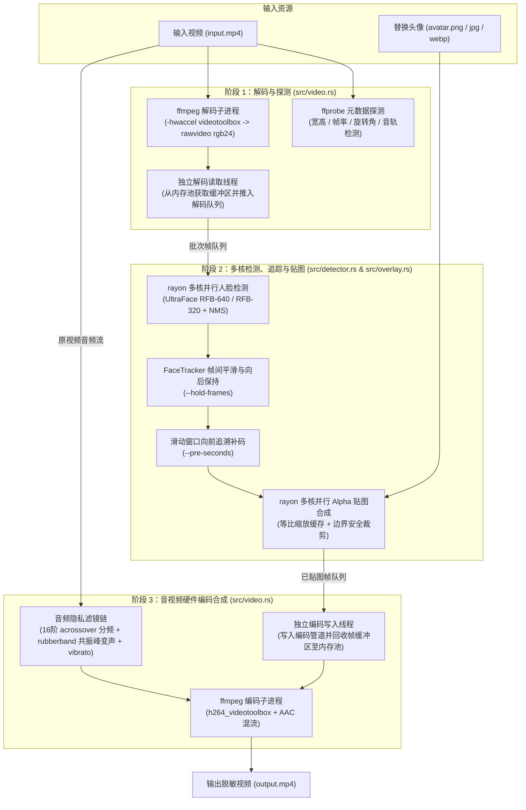

# clear_face — 视频人脸贴图替换与人声隐私变声工具

`clear_face` 是一个基于 Rust 编写的高性能 MP4 视频隐私脱敏命令行工具。它能够自动检测视频中的所有出现的人脸（支持多人脸、侧脸与远景小脸），将其替换为指定的头像图片（如带透明通道的葫芦娃 PNG 头像），同时对视频中的人声频段进行不可逆的隐私变声处理，并保留非人声的环境背景音。

---

## 核心特性

- **纯 Rust 零外部动态库编译**：内置轻量级 UltraFace 预训练模型（`RFB-640` 高清模型与 `RFB-320` 极速模型），通过纯 Rust ONNX 推理引擎 `tract-onnx` 编译进单一可执行文件，无需安装 OpenCV。
- **防闪烁追踪与向前追溯补码（Lookback Buffer）**：
  - **向后保持（`--hold-frames`）**：人物快速转头或短暂遮挡导致单帧漏检时，自动沿用并平滑上一帧人脸位置，避免头像闪烁。
  - **向前补码（`--pre-seconds`）**：在内存中维护滑动窗口缓冲队列，一旦检测到新出现的人脸，自动向前追溯指定秒数的缓冲帧，在未打码的相同位置补上头像。
- **人声频段分离隐私变声**：
  - 采用 16 阶（`-96dB/oct`）Linkwitz-Riley 分频器将音轨切分为 `<90Hz`（环境低频）、`90Hz~4500Hz`（人声基频与共振峰）和 `>4500Hz`（环境高频细节）。
  - 仅对人声频段执行 `rubberband` 音高+声道共振峰偏移（Formant Shifting）与微颤非线性调制（`vibrato`），既防止逆向调音还原真实声纹，又保留自然的脚步、碰撞等环境背景声。
- **高性能三级并发流水线 + 硬件加速**：
  - **macOS `VideoToolbox` 硬件加速**：默认启用硬件解码与 `h264_videotoolbox` 硬件编码。
  - **三级异步流水线 + `rayon` 多核并行**：独立解码读取线程、多核并行 ONNX 推理与并行 Alpha 贴图线程、独立编码写入线程并发运行，配合帧内存池循环复用，大幅提升 1080p/4K 视频吞吐率。

---

## 系统架构



### 目录与模块说明

```text
clear_face/
├── Cargo.toml                  # 项目依赖配置
├── models/
│   ├── version-RFB-640.onnx    # 内嵌的高清人脸检测模型 (640x480 输入)
│   └── version-RFB-320.onnx    # 内嵌的极速人脸检测模型 (320x240 输入)
└── src/
    ├── main.rs                 # CLI 命令行参数解析与主入口
    ├── detector.rs             # ONNX 模型推理、NMS 抑制与 FaceTracker 防抖追踪器
    ├── overlay.rs              # 头像等比缩放缓存与 RGBA -> RGB 边界裁剪透明混合
    └── video.rs                # ffprobe 探测、三级并发流水线、向前补码与 FFmpeg 音视频编码
```

---

## 环境依赖与编译

### 1. 系统依赖
需安装 `ffmpeg`（包含 `ffprobe` 及 `rubberband` 滤镜，macOS Homebrew 默认已包含）：
```bash
brew install ffmpeg
```

### 2. 编译发布版本
请务必使用 `--release` 模式编译以获得完整的 SIMD 与多核优化性能：
```bash
cargo build --release
```
编译产物位于 `./target/release/clear_face`（ONNX 模型已通过 `include_bytes!` 内嵌至二进制文件中，可将该可执行文件复制到任意目录独立运行）。

---

## 命令行参数说明

```bash
./target/release/clear_face [OPTIONS] --input <INPUT> --avatar <AVATAR> --output <OUTPUT>
```

| 参数 | 短参数 | 默认值 | 说明 |
| :--- | :---: | :---: | :--- |
| `--input <PATH>` | `-i` | **必填** | 输入 MP4 视频文件路径 |
| `--avatar <PATH>` | `-a` | **必填** | 用于替换人脸的头像图片路径（支持 PNG 透明通道、JPG、WebP） |
| `--output <PATH>` | `-o` | **必填** | 输出 MP4 视频文件路径 |
| `--scale <FLOAT>` | `-s` | `1.3` | 头像相对于人脸检测框的缩放比例（`1.3` 可完整遮住头发与下巴，保持头像原始宽高比） |
| `--threshold <FLOAT>` | `-t` | `0.7` | 人脸检测置信度阈值（范围 `0.05 ~ 1.0`，值越小越容易检出模糊侧脸） |
| `--iou-threshold <FLOAT>` | 无 | `0.3` | NMS 非极大值抑制 IoU 阈值（范围 `0.0 ~ 1.0`） |
| `--hold-frames <NUM>` | 无 | `5` | 短暂漏检向后保持帧数（防止人物快速转头时头像闪烁，设为 `0` 关闭） |
| `--pre-seconds <FLOAT>` | 无 | `0.08` | 检测到人脸后向前追溯补码的秒数（将前序未打码帧的相同位置一并打码） |
| `--detect-interval <NUM>` | 无 | `2` | 每隔多少帧执行一次神经网络检测（默认每 `2` 帧检测一次，中间帧复用追踪位置；设为 `1` 则逐帧检测） |
| `--fast-model` | 无 | `false` | 启用轻量级 `320x240` 检测模型（计算量降为 1/4，适合非密集远景小脸的普通视频） |
| `--voice-pitch <FLOAT>` | 无 | `1.38` | 人声隐私变声音高系数（范围 `0.3 ~ 3.0`；`1.38` 为卡通/葫芦娃高音色，`0.72` 为低沉大叔音色） |
| `--keep-audio` | 无 | `false` | 禁用人声变声，直接无损复制原视频音频流（`-c:a copy`） |
| `--sw-codec` | 无 | `false` | 禁用 macOS `VideoToolbox` 硬件加速，强制使用 CPU 软编解码（`libx264`） |

---

## 常用示例

### 1. 标准模式（高清人脸检测 + 自动人声变声 + 硬件加速）
```bash
./target/release/clear_face \
  --input input.mp4 \
  --avatar huluwa.png \
  --output output.mp4
```

### 2. 极速模式（适合长视频快速处理，启用 `RFB-320` 模型）
```bash
./target/release/clear_face \
  --input input.mp4 \
  --avatar huluwa.png \
  --output output.mp4 \
  --fast-model
```

### 3. 将人声变成低沉男声并放大头像遮挡范围
```bash
./target/release/clear_face \
  --input input.mp4 \
  --avatar huluwa.png \
  --output output.mp4 \
  --scale 1.5 \
  --voice-pitch 0.72
```

### 4. 仅替换人脸，保留原视频原始声音
```bash
./target/release/clear_face \
  --input input.mp4 \
  --avatar huluwa.png \
  --output output.mp4 \
  --keep-audio
```
